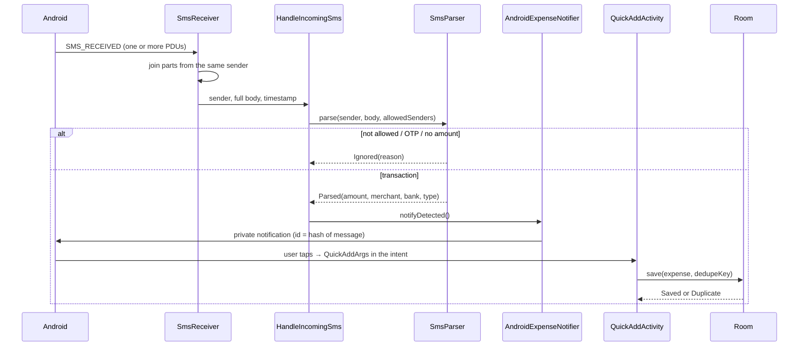

# Architecture

Expense Interceptor is a single-module Android app with a deliberately strict dependency direction:

```
ui  ──►  domain  ◄──  data / notification / receiver
          ▲
          └── ports (interfaces) implemented by data
```

- `domain/` holds the rules: `Money`, `Expense`, `DateRanges`, `SmsParser`, `SmsFingerprint`, the use cases and the **ports** (`ExpenseRepository`, `SmsInbox`, `ExpenseNotifier`, `SenderSettings`, `ExportFileStore`, `PdfReportWriter`). It does not import `android.*`.
- `data/`, `notification/` and `receiver/` implement the ports with Room, the SMS content provider, `NotificationManager`, SharedPreferences and Apache POI.
- `ui/` renders state. Each screen has a view model that exposes one immutable state object and one-shot events.
- `di/` has two Hilt modules: `AppModule` (database, clock, zone) and `BindingsModule` (port → implementation).

Why bother for an app this size? Every behaviour that matters (what counts as a transaction, what counts as a duplicate, how a month is bounded) can be tested on the JVM in milliseconds with fakes, while the Android edges stay thin.

## How an SMS becomes an expense



The parser applies these rules in order ([SmsParserTest](app/src/test/java/com/expenseinterceptor/domain/sms/SmsParserTest.kt) is the executable specification):

1. **Sender** must contain one of the user's sender ids (case-insensitive substring; blank ids never match).
2. **OTP and verification messages** are dropped.
3. **Direction** is the keyword that appears *first* (`debited`, `spent`, `paid` ... vs `credited`, `received`, `refund` ...), after removing the product names "credit card" and "debit card". No keyword means "not a transaction".
4. **Amount** is the first `Rs` / `INR` / `₹` figure that is not preceded (within 28 characters) by balance words such as `Avl Bal`, `limit`, `outstanding`.
5. **Merchant** follows `at / to / for / VPA / info:` for debits and `from / by / VPA / info:` for credits; account references (`A/c XX1234`) are skipped.
6. **Bank** is the stable middle of the sender id (`CF-HASTIB-S` → `HASTIB`).

## Data model

One table, `expenses` (schema v3, exported to [`app/schemas`](app/schemas)):

| Column | Type | Notes |
| :-- | :-- | :-- |
| `id` | INTEGER PK | auto-generated |
| `amountMinor` | INTEGER | paise; see [ADR 0001](docs/adr/0001-money-as-integer-paise.md) |
| `merchant`, `category`, `title`, `bank` | TEXT | `title` optional |
| `timestamp` | INTEGER | epoch ms; indexed |
| `originalSms` | TEXT | the message, kept for audit; nullable |
| `transactionType` | TEXT | `DEBIT` / `CREDIT` |
| `dedupeKey` | TEXT, **unique**, nullable | SHA-256 fingerprint of the SMS; null for manual/imported rows |

Migrations: 1→2 added `bank` and `transactionType`; 2→3 rebuilt the table for integer money and the new key and index. Both are exercised against real SQLite files in `RoomTest`, and Room's own post-migration schema validation proves the rebuilt table matches the entity.

## Duplicate handling

| Path | Mechanism |
| :-- | :-- |
| Same SMS saved twice (notification tapped twice, scan after live capture) | Unique `dedupeKey` + `INSERT ... IGNORE` |
| Re-scanning the inbox | Detected messages are looked up by key and shown as "already saved" |
| Re-importing a file | Content check: same second, amount, merchant, direction |

## Time

`DateRanges(clock, zone)` is the only place that turns "this month" or "a day" into a half-open `[start, end)` range. The clock and zone are injected, so tests use a fixed instant in `Asia/Kolkata` and a DST month in `America/New_York`.

## Concurrency and state

View models expose `StateFlow` state and a `Channel`-backed `Flow` of events (snackbars, share requests), so an event is delivered once and never replayed after rotation. Room queries return `Flow`, which keeps lists and totals live. Heavy work (file parsing, inbox reads, exports) runs on `Dispatchers.IO` / `Default`.

## Testing strategy

| Layer | How |
| :-- | :-- |
| Parser, money, dates, dashboard maths | Plain JUnit, table-driven |
| Use cases, view models | Fakes from `support/Fakes.kt` that mirror the Room duplicate rules, Turbine for events |
| CSV / Excel | Round trips, hostile input, limits |
| Room | Robolectric with real SQLite, including migrations from hand-built v1 and v2 files |
| Receiver | Real GSM PDUs through the platform `SmsMessage` parser, real notifier, assert on the posted notification and the intent behind it |
| Whole app | Robolectric boots `MainActivity` with the real Hilt graph and walks the screens |
| Privacy | `PrivacyInvariantsTest` parses the manifest and sources |

## Not covered yet

Instrumented tests on a real device (permission prompts, PDF rendering, the minified build) are not part of CI; see the README's limitations.
