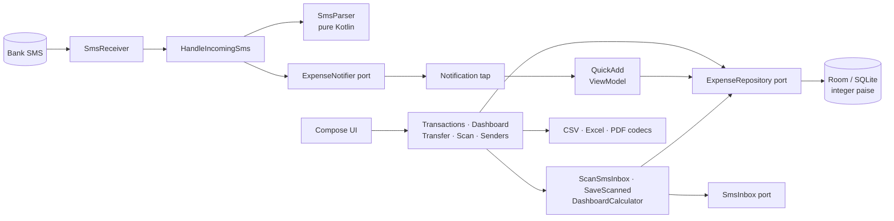

# Expense Interceptor

**A privacy-first Android app that reads bank transaction SMS on the device, turns them into categorised expenses in two taps, and never talks to a server.**

[](https://github.com/dipesh9765/money-tracking-mobile-application/actions/workflows/android-ci.yml)
[](https://kotlinlang.org/)
[](https://developer.android.com/jetpack/compose)
[](https://dagger.dev/hilt/)
[](LICENSE)

A bank texts you "Rs.1,234.50 debited from A/c XX1234 at BIG BAZAAR". The app recognises it, posts a notification, and a tap opens a small dialog with amount, merchant and bank already filled in. Pick a category, save. The same engine can backfill months of old messages, show charts, and import/export CSV, Excel and PDF.

## Why it is interesting

- **The parser is the product, and it is tested like one.** [`SmsParser`](app/src/main/java/com/expenseinterceptor/domain/sms/SmsParser.kt) is pure Kotlin with 16 table-driven tests. It understands Indian amount formats (`Rs.1234.56`, `1,23,456.00`, `₹`), ignores OTPs and offers, never mistakes an available balance for the amount, and classifies UPI messages that say *"debited ... credited to MERCHANT"* as debits. [The rules are written down](ARCHITECTURE.md#how-an-sms-becomes-an-expense).
- **Money is integer paise.** `Double` rounding drift cannot appear in totals; a `Money` value class does the arithmetic ([ADR 0001](docs/adr/0001-money-as-integer-paise.md)).
- **Privacy is enforced by tests, not just promised.** A build fails if the manifest gains `INTERNET`, backup is switched on, an HTTP library appears, or code logs through `Log.d`/`println`. Notifications are private on the lock screen. See [PRIVACY.md](PRIVACY.md).
- **No duplicates.** Live SMS, inbox rescans and file imports all converge on the same rows through a message fingerprint and a content check ([ADR 0003](docs/adr/0003-sms-dedupe-key.md)).
- **Lossless data portability.** CSV and Excel exports include bank and direction and re-import identically; CSV output is hardened against spreadsheet formula injection from hostile SMS text.
- **Real engineering around it.** Layered architecture with ports and use cases, Hilt, Room with exported schemas and tested migrations, 143 tests, detekt with an empty baseline, Android Lint, ktfmt, a coverage gate, R8, and CI.

## Features

| Area | What you get |
| :-- | :-- |
| Interception | Receiver for incoming bank SMS; long messages sent in several parts are joined before parsing |
| Quick categorise | Notification opens a transparent dialog, prefilled; handles several notifications in a row |
| Bank senders | Add or remove the sender ids you trust in the app (no source edits). Defaults cover common Indian banks |
| Transactions | Date range, swipe to delete with undo, tap to edit category, bank and direction, totals for spent and received |
| Dashboard | Bar, line and pie charts (Vico + Canvas); filter by category, bank, debit/credit; daily, weekly (Mon-Sun), monthly buckets |
| Scan old SMS | Backfill a date range from the inbox; shows which messages are new and which are already saved |
| Export | Formatted text, CSV, Excel (.xlsx), PDF through the share sheet; files are deleted after a day |
| Import | CSV or Excel, duplicate-safe, row-level error report, 5 MB / 50,000 row limits |

## Architecture



The domain layer (`domain/`) has no Android imports except `javax.inject`; Android details (content provider, notifications, SharedPreferences, FileProvider) live behind ports in `data/` and `notification/` and are bound by one Hilt module. Details and trade-offs are in [ARCHITECTURE.md](ARCHITECTURE.md) and [docs/adr](docs/adr).

```
app/src/main/java/com/expenseinterceptor/
├── domain/         Money, Expense, DateRanges, SmsParser, use cases, ports (no Android)
├── data/
│   ├── local/      Room entity, DAO, migrations (schemas exported to app/schemas)
│   ├── repository/ RoomExpenseRepository
│   ├── sms/        ContentResolverSmsInbox
│   ├── settings/   SharedPrefsSenderSettings
│   └── transfer/   CSV / Excel codecs, exporter, importer, file store, PDF writer
├── notification/   AndroidExpenseNotifier
├── receiver/       SmsReceiver (Hilt entry point)
├── di/             Hilt modules
└── ui/             Compose screens and view models (main, quickadd, scan, settings)
```

## Quick start

Requirements: JDK 17, Android SDK 36 (min SDK 26), Android Studio with AGP 9.

```bash
git clone https://github.com/dipesh9765/money-tracking-mobile-application.git
cd money-tracking-mobile-application
echo "sdk.dir=/path/to/Android/Sdk" > local.properties   # Android Studio does this for you
./gradlew assembleDebug                                   # app/build/outputs/apk/debug
```

Install the APK, grant **SMS** and **Notification** permissions, then open the overflow menu → **Bank senders** and add the id your bank uses (for `VM-HDFCBK-S` add `HDFCBK`).

### Commands

| Command | What it does |
| :-- | :-- |
| `./gradlew testDebugUnitTest` | 143 JVM tests (Robolectric for Room, receiver and UI smoke tests) |
| `./gradlew koverHtmlReportDebug` | Coverage report in `app/build/reports/kover` |
| `./gradlew spotlessApply` | Format with ktfmt |
| `./gradlew detekt lintDebug` | Static analysis |
| `./gradlew assembleRelease` | Minified release APK (signed only if a keystore is configured) |

### Signed releases

Push a version tag (`git tag v1.1.0 && git push origin v1.1.0`) and the [release workflow](.github/workflows/release.yml) builds the APK and attaches it to a GitHub release. Add the secrets `KEYSTORE_BASE64`, `KEYSTORE_PASSWORD`, `KEY_ALIAS` and `KEY_PASSWORD` to sign it; without them the APK is unsigned.

## Permissions

| Permission | Why |
| :-- | :-- |
| `RECEIVE_SMS` | Be told when a bank SMS arrives |
| `READ_SMS` | Backfill from the inbox ("Scan old SMS") |
| `POST_NOTIFICATIONS` | Show the "tap to categorise" notification |

There is no `INTERNET` permission; CI fails if one appears.

## Engineering quality

| Area | What is in place |
| :-- | :-- |
| Tests | 143 tests: parser tables, money, date ranges (including DST and zones), dashboard maths, CSV/Excel round trips and error paths, use cases, every view model (Turbine), Room against real SQLite, **v1→v3 and v2→v3 migrations**, the receiver driven by real SMS PDUs, and a smoke test that boots the real activity with the real Hilt graph |
| Mutation spot check | Breaking the formula guard or the debit/credit order fails 14 tests |
| Coverage | Kover, 79.4% of non-UI lines, 75% enforced in CI |
| Static analysis | ktfmt (Spotless), detekt with **no baseline**, Android Lint with `abortOnError` |
| Privacy checks | `PrivacyInvariantsTest` plus a CI step that inspects the merged release manifest |
| Release | R8 minify and resource shrinking, tag-triggered release workflow |

## Known limitations

- Not run on a physical device in this overhaul: the SMS receiver, notification permission flow, Android 13+ prompts, PDF rendering and the minified release APK were verified through Robolectric and builds only. Smoke-test on a phone before sharing an APK.
- `READ_SMS` and `RECEIVE_SMS` are restricted permissions on Google Play; this app is meant to be sideloaded ([ADR 0004](docs/adr/0004-sms-permissions-and-distribution.md)).
- Parsing is heuristic and tuned for Indian bank formats. A new bank format may need a parser rule; add a row to `SmsParserTest` first.
- Two byte-identical SMS on the same UTC day collapse into one expense (see ADR 0003). Real bank messages carry balances or references, which makes this rare.
- The database is not encrypted (ADR 0002). Anyone with the unlocked device or root can read it.
- Backups are off by design: use Export to move data between phones.
- The time zone is read at launch.

## Roadmap

Budgets per category, recurring-payment detection, per-bank parser rule packs loaded from a file, and an instrumented test suite for the Android 13+ permission flow.

## Contributing and license

See [CONTRIBUTING.md](CONTRIBUTING.md) and [SECURITY.md](SECURITY.md). Released under the [MIT License](LICENSE).
